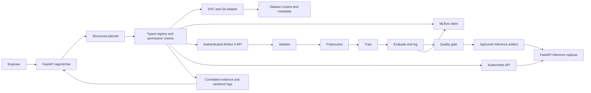
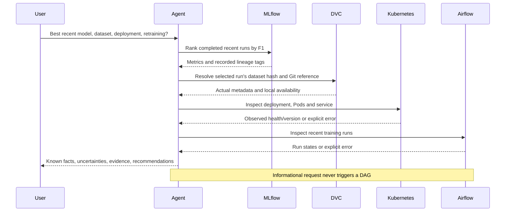

# Architecture and engineering rationale

The application combines a conversational control plane with four typed adapters. Training and inference are separate workloads. DVC supplies content and source references; MLflow supplies recorded experiment results; Airflow owns ordered execution; Kubernetes supplies observed deployment state. The agent never treats a missing response as successful infrastructure execution.

## Control flow

`api/main.py` exposes the HTTP interface; `agent/orchestrator.py` selects and sequences tools; `agent/schemas.py` validates the public contract. Each adapter registers a name, description, input schema, output schema, permission class and timeout. Model-generated arguments pass the same server-side validation as offline requests. Tool outputs are evidence, not new instructions.

Two planner modes serve different purposes:

- A configured LLM provider uses structured function calls. It is the natural-language reasoning path; an API key and reachable provider are required for real provider verification.
- The offline planner uses deterministic routing to support repeatable tests and demonstrations. Its responses identify that mode. It is not evidence of LLM reasoning.

The system bounds tool work and returns failed calls explicitly. An error includes a safe code and uncertainty instead of fabricated run IDs, hashes, healthy Pods or successful retraining. HTTP and subprocess clients also impose their own timeouts, so a slow service does not create an unbounded operation.

## Mandatory four-system request

Selection of a high-F1 experimental run does not establish production readiness. The conclusion must also consider data provenance, gate outcome, deployed version and available health. Retraining requires a stated freshness policy, a failed gate or measured degradation; lack of access alone is not evidence that a model needs training.

## Data provenance and artifacts

The deterministic sample has eight numeric features and a binary target. A fixed generation seed and split seed permit reruns. DVC metadata records dataset content identity; Git records source and metadata identity. These identities answer different questions and must not be substituted for each other.

Training records the dataset content hash, Git commit, training configuration, split, metrics, MLflow run ID and artifact location. The trained `joblib` bundle contains the estimator, feature order and metadata. A gate controls promotion to the artifact loaded by inference. Validation and gate failures prevent promotion. Airflow tasks share a durable artifact directory, not an assumed worker-local path. Multi-worker installations must mount the same storage at the same path.

A historical DVC reproduction uses a disposable clone and approved DVC operations. It does not switch or reset the working development checkout. A Git revision without its data in the DVC cache or remote is an incomplete reproduction and is reported accordingly.

## Permissions and trust boundaries

| Boundary | Enforcement | Consequence |
| --- | --- | --- |
| User/model to tools | Pydantic validation and fixed registry | Unknown tools and invalid arguments fail before execution |
| User/model to shell | Fixed DVC/Git argument templates | No free-form shell command execution |
| Agent to Airflow | Configured origin, authentication and approved DAG | Arbitrary DAG execution is excluded |
| Agent to Kubernetes | Configured namespace and read-only tools/RBAC | No cluster mutation endpoint is exposed |
| Tool output to planner | Data-only evidence | Tool text does not grant permission |
| Request to write execution | Bound, expiring, single-use confirmation | A read request cannot silently authorize retraining |
| Runtime to repository | Ignored secrets, caches and generated models | Credentials and bulky runtime state remain outside Git |

For a write proposal, the server validates the action and arguments, binds a token to the session, action, arguments, expiry and nonce, then requires that token on a matching follow-up. It rechecks permissions before execution. Tokens are not broad authorization to perform other actions. A restarted or horizontally replicated agent needs shared confirmation state or the documented single-process deployment; this demo does not claim a distributed authorization service.

The public API is a development interface. Bind it to loopback for local work. A production deployment also needs authenticated users, TLS, a reverse proxy, authorization policy, rate limiting, durable audit storage and managed secrets. CORS or session IDs do not authenticate an operator.

## Evidence and logging

Tool traces carry the request/session correlation, tool name, result status and evidence. Structured logs retain timestamp, request ID, duration, tool and sanitized error code; they do not retain credentials or full request bodies. Per-system evidence and conversations live under `evidence/`.

Evidence labels mean:

| Label | Meaning |
| --- | --- |
| `VERIFIED_REAL` | The recorded operation executed against an actual local or remote service/data source |
| `VERIFIED_MOCKED` | The operation exercised controlled fixtures; no live infrastructure claim follows |
| `BLOCKED` | A concrete prerequisite prevented the operation |
| `FAILED` | The operation ran and failed; diagnosis and next action must be retained |

A successful API submission is not a successful DAG. A running process is not a ready model. A manifest is not a running cluster. A mock is not a service integration. The report preserves these distinctions.

## Why these components

FastAPI and Pydantic make request and tool contracts inspectable. MLflow's supported client avoids fragile UI scraping. `httpx` exposes Airflow 3 HTTP failures and supports bounded calls. The Kubernetes Python client provides typed API resources while namespaced RBAC limits access. DVC and Git provide complementary reproducibility references. The compact scikit-learn task keeps demonstrations reproducible on CPU and leaves assessment focused on integration and operational correctness.
